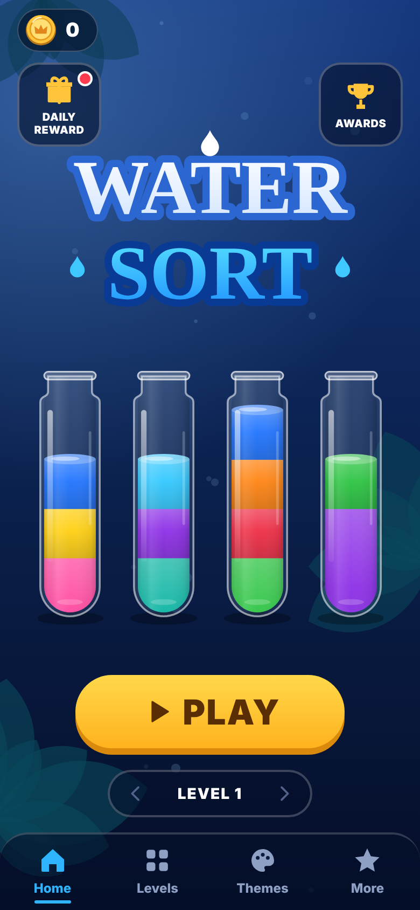
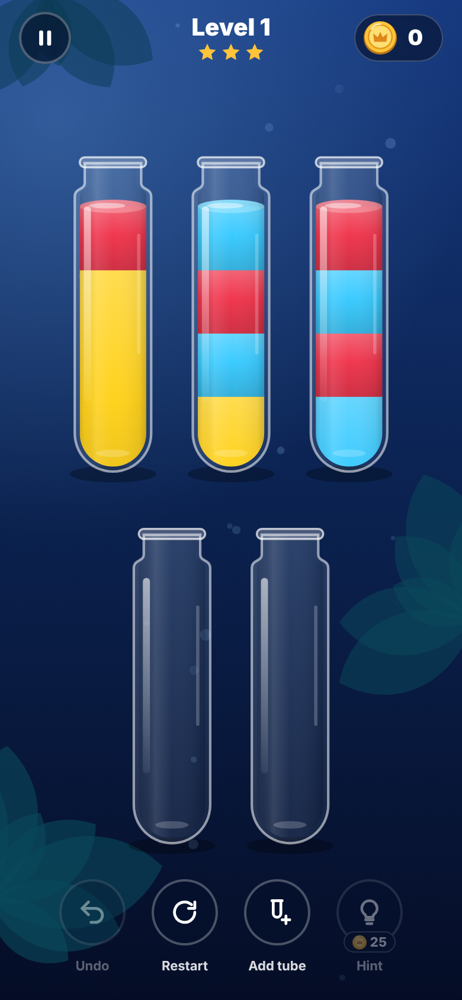

# Water Sort

A water-sort puzzle game for Android built with Expo, React Native and TypeScript. It has 300 levels, with no ads and no purchases.

<p>
  
  
</p>

## Features

- 300 levels, each checked for a solution
- Pour animation with liquid physics
- Detects unwinnable positions and offers Undo, Add Tube or Restart
- Hints, daily rewards and achievements
- Bottles, backgrounds, logo and icons drawn in code with SVG
- Layout adapts to small screens and levels with many bottles

## How it works

- `src/game/` holds the rules, solver, themes and level data, with no UI dependencies.
- `src/art/` draws the bottles, liquid, backgrounds and icons.
- `src/ui/` holds the board, pour animation and screens.
- `src/config.ts` sets the game title, hint cost and rewards.
- `scripts/generateLevels.ts` generates the levels and uses the solver to keep only solvable ones.

## Run it

```
npm install
npx expo start
```

## Tests

```
npm test
npm run typecheck
```

`npm test` solves all 300 levels, replays each solution, and checks the pour animation at several screen sizes.

## Build

The GitHub Actions workflow builds a release APK when it is run manually.

## Stack

Expo SDK 57, React Native, TypeScript, React Native SVG, AsyncStorage
